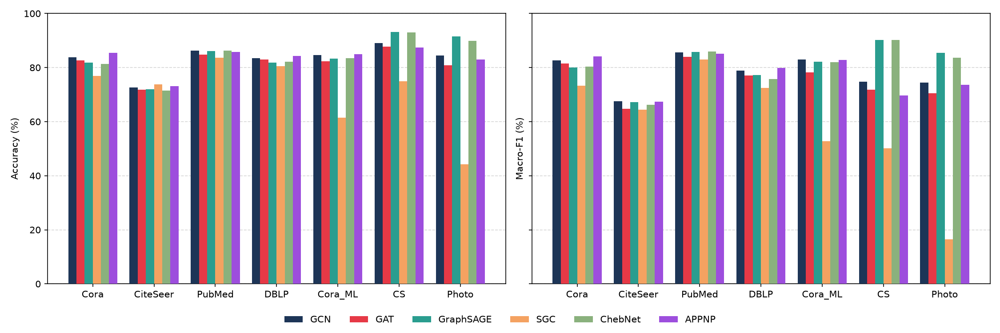
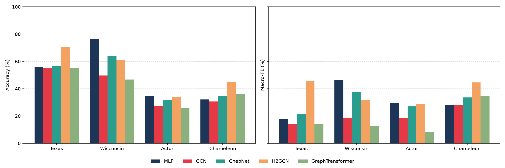

# GNN Node Classification Benchmark

Code for the experimental chapter of my bachelor's thesis, *Node Classification: Formulation, Methodologies and Applications* (University of Padua, 2025/26, supervisor Prof. Ornella Irrera).

It compares 8 graph models and an MLP baseline on 11 datasets, under one protocol, to answer a simple question: when does using the graph help, and when does it hurt?

The models are GCN, GAT, GraphSAGE, SGC, ChebNet, APPNP, H2GCN and a global Graph Transformer with Laplacian positional encodings. H2GCN and the Graph Transformer are implemented from scratch in PyTorch. The others use PyTorch Geometric layers.

## Key findings

- **Message passing can lose to a model that ignores the graph.** On Wisconsin (homophily 0.20) an MLP reaches 76.6% accuracy against 49.8% for GCN.
- **Preprocessing can decide the ranking.** Row-normalizing the features took SGC from 92.8% to 44.3% on Amazon Photo, because it shrinks the inputs of a linear model until it predicts the majority class. The same choice saved GraphSAGE, which fell from 91.3% to 47.5% without it. [Details](#feature-normalization-changes-the-ranking).
- **Edge direction matters as much as the architecture.** H2GCN looked best on Chameleon, but it symmetrizes the edges and GCN did not. With undirected edges GCN goes from 33.1% to 49.8% and beats it. [Details](#edge-direction-changes-the-result-on-chameleon).

## Results

These are the numbers reported in the thesis: test accuracy / macro-F1 in %, one seed, Colab GPU. The best accuracy per dataset is in bold. See [Limitations](#limitations) before reading much into small gaps.

### Homophilous graphs

| Dataset | Homophily | GCN | GAT | GraphSAGE | SGC | ChebNet | APPNP |
|---|---|---|---|---|---|---|---|
| Cora | 0.81 | 83.87 / 82.61 | 82.67 / 81.48 | 81.89 / 80.05 | 76.99 / 73.25 | 81.38 / 80.42 | **85.40** / 84.22 |
| CiteSeer | 0.74 | 72.60 / 67.53 | 71.85 / 64.70 | 71.93 / 67.20 | **73.73** / 64.43 | 71.55 / 66.27 | 73.09 / 67.34 |
| PubMed | 0.80 | **86.31** / 85.67 | 84.85 / 83.99 | 86.04 / 85.70 | 83.63 / 82.95 | 86.26 / 85.94 | 85.77 / 85.07 |
| DBLP | 0.83 | 83.52 / 78.88 | 82.91 / 77.04 | 81.88 / 77.24 | 80.56 / 72.40 | 82.13 / 75.84 | **84.37** / 79.84 |
| Cora-ML | 0.79 | 84.61 / 83.03 | 82.31 / 78.21 | 83.31 / 82.10 | 61.54 / 52.81 | 83.52 / 82.02 | **84.98** / 82.87 |
| Coauthor CS | 0.81 | 89.03 / 74.83 | 87.80 / 71.82 | **93.13** / 90.29 | 75.02 / 50.17 | 92.96 / 90.21 | 87.45 / 69.73 |
| Amazon Photo | 0.83 | 84.44 / 74.49 | 80.88 / 70.58 | **91.50** / 85.53 | 44.30 / 16.47 | 89.95 / 83.58 | 83.01 / 73.71 |



### Heterophilous graphs

| Dataset | Homophily | MLP | GCN | ChebNet | H2GCN | Graph Transformer |
|---|---|---|---|---|---|---|
| Texas | 0.11 | 55.78 / 17.87 | 55.10 / 14.27 | 56.46 / 21.39 | **70.75** / 45.72 | 55.10 / 14.21 |
| Wisconsin | 0.20 | **76.62** / 46.27 | 49.75 / 18.87 | 64.18 / 37.53 | 61.19 / 31.87 | 46.77 / 12.75 |
| Actor | 0.22 | **34.51** / 29.55 | 27.43 / 18.32 | 31.86 / 26.98 | 33.82 / 28.90 | 25.87 / 8.22 |
| Chameleon | 0.24 | 32.07 / 27.85 | 30.64 / 28.26 | 34.38 / 33.66 | **45.03** / 44.58 | 36.41 / 34.34 |



## What I found after the thesis

Going back over the results, two of them turned out to be caused by the setup rather than by the models. The thesis tables above are unchanged, so these checks correct how they should be read.

### Feature normalization changes the ranking

The thesis applied `NormalizeFeatures` everywhere. Rerunning every model with and without it gives this test accuracy (`results/normalization_check.csv`):

| Model | CS, normalized | CS, raw | Photo, normalized | Photo, raw |
|---|---|---|---|---|
| GCN | 89.22 | 92.88 | 84.49 | 92.70 |
| GAT | 87.75 | 92.49 | 87.48 | **93.48** |
| APPNP | 87.57 | **93.16** | 83.61 | 92.12 |
| SGC | 75.02 | 93.09 | 44.30 | 92.83 |
| GraphSAGE | 93.13 | 92.84 | 91.32 | 47.45 |
| ChebNet | 92.98 | out of memory | 90.08 | 41.88 |

- **Why SGC collapses:** normalization divides each row by its sum, so Photo's feature norm drops from about 15 to 0.08. SGC is linear, so it would need huge weights, while weight decay pulls them toward zero. The logits stay almost equal, the bias decides, and the model predicts the majority class.
- **Why GraphSAGE and ChebNet collapse on raw Photo:** this is the opposite problem, large inputs at a learning rate of 0.05 make training unstable. My guess is that their non-aggregated "self" term passes the raw input straight through, but I haven't verified it.
- **What it means:** GraphSAGE's lead on CS and Photo mostly comes from this preprocessing choice. Without normalization GCN, GAT, APPNP and SGC all reach about 93%. Preprocessing should be selected on validation data for each model, like any other hyperparameter.

To reproduce: `python run_experiment.py homophilous --no-normalize`.

### Edge direction changes the result on Chameleon

The four heterophilous graphs are directed in PyTorch Geometric. GCN and ChebNet used the edges as they are, while H2GCN and the Graph Transformer symmetrize them internally, so the comparison wasn't even. This is the test accuracy / macro-F1 with the same CPU setup (`results/heterophilous_undirected.csv`):

| Dataset | GCN, directed | GCN, undirected | ChebNet, directed | ChebNet, undirected | H2GCN |
|---|---|---|---|---|---|
| Texas | 51.70 / 14.91 | 56.46 / 20.74 | 55.78 / 20.01 | 60.54 / 29.10 | **70.07** / 44.46 |
| Wisconsin | 49.25 / 17.17 | 56.22 / 29.36 | 63.18 / 36.68 | **66.67** / 36.06 | 63.68 / 33.66 |
| Actor | 26.99 / 18.10 | 29.31 / 21.81 | 31.05 / 24.55 | 32.35 / 26.89 | **33.75** / 28.25 |
| Chameleon | 33.06 / 31.21 | **49.81** / 49.86 | 33.22 / 32.29 | 37.34 / 35.91 | 44.92 / 44.82 |

H2GCN's lead on Texas holds. On Chameleon it doesn't: plain GCN wins once it gets the same undirected graph.

To reproduce: `python run_experiment.py heterophilous --undirected --models GCN ChebNet`.

## Protocol

- **Split:** stratified 10% train / 10% validation / 80% test.
- **Features:** `NormalizeFeatures`.
- **Training:** Adam and NLL loss, up to 1000 epochs, early stopping on validation loss with patience 100, restoring the best epoch.
- **Homophilous experiment:** learning rate 0.05 and weight decay 5e-4. SGC uses 0.2 and 5e-5.
- **Heterophilous experiment:** learning rate 0.01 and weight decay 5e-4.
- **Architectures:** 64 hidden channels, dropout 0.5. GAT uses 8 heads of 8 channels and dropout 0.6. ChebNet has K=3, SGC K=2, APPNP K=10 and alpha=0.1, H2GCN K=2. The Graph Transformer has 2 layers, 4 heads and an 8-dimensional positional encoding.
- **Metrics:** accuracy and macro-F1 on the test set.

## Usage

```bash
pip install -r requirements.txt

python run_experiment.py homophilous      # writes results/homophilous.csv
python run_experiment.py heterophilous    # writes results/heterophilous.csv
python dataset_stats.py                   # Table 5.1 of the thesis
python grid_search.py                     # hidden size and learning rate grid
python plot_results.py results/thesis_homophilous.csv figures/homophilous.png
```

Datasets are downloaded to `data/` on first use. Add `--datasets` and `--models` to run a subset, for example `python run_experiment.py heterophilous --datasets Texas --models H2GCN`.

A GPU is strongly recommended for the homophilous experiment: ChebNet on Coauthor CS is very slow on a CPU. The heterophilous experiment runs on a laptop in under an hour.

## Repository layout

```
gnnbench/
  data.py            dataset loading, stratified split, edge homophily
  models.py          all models, including H2GCN and the Graph Transformer
  training.py        seeding, metrics, training loop
run_experiment.py    the two benchmarks
grid_search.py       hyperparameter grid
dataset_stats.py     dataset statistics
plot_results.py      bar charts
results/             result CSVs, including the original thesis tables
figures/             charts used in this README
```

## Reproducibility

This code is a refactor of the original Colab notebook. I checked it by running both versions on the same CPU setup, comparing accuracy, macro-F1 and best epoch:

- **Heterophilous experiment:** 18 of 20 runs are identical. The other two are Graph Transformer runs, explained below.
- **Homophilous experiment:** all 18 runs on Cora, CiteSeer and Cora-ML are identical, covering all six models. PubMed, DBLP, Coauthor CS and Amazon Photo were not compared.

The numbers won't match the thesis tables exactly, because those came from a Colab GPU. The CPU runs here differ by up to 6.4 points with the same seed and split (MLP on Chameleon: 32.07 on GPU, 38.50 on CPU).

With SciPy 1.17 the original Graph Transformer code isn't deterministic: the eigensolver starts from a random vector that `np.random.seed` doesn't control, so the signs of the positional encoding change on every run. This code derives the start vector from the seed, and repeated runs are now identical. The sign choice alone moves Chameleon between 31.80% and 38.44%.

## Limitations

- **One seed and one split.** Gaps of a few points mean little. GAT on Photo scored 80.88% in the thesis and 87.48% when the same code was rerun on GPU.
- **Hyperparameters weren't chosen on validation data.** The notebook's grid search logged test scores only. `grid_search.py` now logs validation scores too, but the thesis values are unchanged.
- **The split isn't the standard one.** 10/10/80 can't be compared with published results, which use the Planetoid or Geom-GCN splits.
- **Texas and Wisconsin are very small** (183 and 251 nodes), so a few nodes move accuracy by whole points.
- **Texas has a single-node class.** That node always lands in the test set and can't be learned, so macro-F1 there can't exceed 80%.
- **H2GCN differs slightly from the paper.** Strict 2-hop edges keep their path counts as weights, while the paper binarizes them.
- **Heterophilous models weren't tuned individually.** They all share one learning rate and weight decay.

## License

MIT
